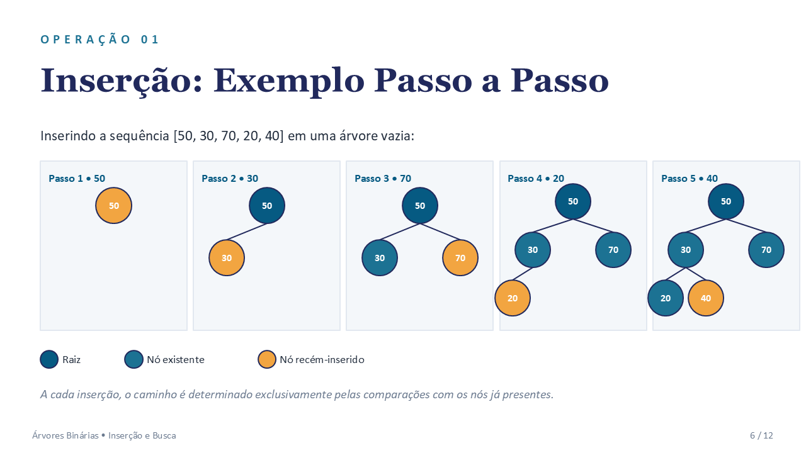

# 🌳 Árvores Binárias — Inserção e Busca

Seminário da disciplina de **Estrutura de Dados** na **Fatec Taquaritinga** sobre **árvores binárias de busca (BST)**: conceitos, operações de **inserção** e **busca**, **complexidade** e **aplicações**, com implementação em **JavaScript**.


| Material | Descrição |
|---|---|
| 📄 [`Documentacao_Arvores_Binarias.pdf`](Documentacao_Arvores_Binarias.pdf) | Documentação completa (24 páginas, normas ABNT) |
| 📊 [`Arvores_Binarias_Insercao_Busca.pptx`](Arvores_Binarias_Insercao_Busca.pptx) | Slides da apresentação (12 slides) |
| 💻 [`arvore-binaria.js`](arvore-binaria.js) | Código de inserção e busca, pronto para rodar |

---

## 🌲 O que é uma árvore binária

Estrutura **hierárquica e não linear** em que cada nó tem **no máximo dois filhos** (esquerdo e direito).

| Termo | Significado |
|---|---|
| **Raiz** | Nó do topo, sem pai |
| **Folha** | Nó sem filhos |
| **Subárvore** | Um nó e todos os seus descendentes |
| **Altura** | Maior caminho da raiz até uma folha |
| **Grau** | Quantidade de filhos de um nó (0, 1 ou 2) |

### Árvore Binária de Busca (BST)

Para todo nó: **esquerda < nó < direita**, em todos os níveis.

```
          50
        /    \
      30      70
     /  \    /  \
   20   40  60   80
```

---

## ➕ Inserção

Compara o valor com cada nó e desce para a **esquerda (menor)** ou para a **direita (maior)** até achar uma posição vazia.



```javascript
function inserir(raiz, valor) {
  if (raiz === null) return new No(valor);
  if (valor < raiz.valor) raiz.esq = inserir(raiz.esq, valor);
  else if (valor > raiz.valor) raiz.dir = inserir(raiz.dir, valor);
  return raiz;
}
```

## 🔍 Busca

A cada comparação, **descarta metade da árvore**. Exemplo, buscando **40**:

> 40 < 50 → esquerda · 40 > 30 → direita · **encontrado!**

```javascript
function buscar(raiz, alvo) {
  if (raiz === null) return null;          // não encontrado
  if (alvo === raiz.valor) return raiz;    // encontrado
  return alvo < raiz.valor ? buscar(raiz.esq, alvo) : buscar(raiz.dir, alvo);
}
```

---

## ⏱️ Complexidade

| Operação | Melhor caso | Caso médio | Pior caso |
|---|:---:|:---:|:---:|
| Inserção | O(log n) | O(log n) | O(n) |
| Busca | O(1) | O(log n) | O(n) |

**Pior caso:** inserindo valores já ordenados (10, 20, 30, 40...), a árvore vira uma **lista**, e a altura passa a ser n. A solução são árvores **balanceadas**, como **AVL** e **Rubro-Negra**.

## 🌐 Aplicações

Índices de **bancos de dados** (B-Tree) · **sistemas de arquivos** (NTFS, HFS+) · **compiladores** (árvores de sintaxe) · **roteamento de redes** · **autocompletar** (Trie) · **sistemas de recomendação**

---

## 🚀 Como rodar o código

Com o [Node.js](https://nodejs.org/) instalado:

```bash
node arvore-binaria.js
```

Saída:

```
Em ordem: 20, 30, 40, 50, 60, 70, 80
Buscar 40: Achou!
Buscar 65: Não existe.
```

---

## 📚 Referências

- CORMEN, T. H. et al. **Algoritmos: teoria e prática**. 3. ed. Rio de Janeiro: Elsevier, 2012.
- SZWARCFITER, J. L.; MARKENZON, L. **Estruturas de dados e seus algoritmos**. 3. ed. Rio de Janeiro: LTC, 2010.

---

## 🎓 Informações acadêmicas

| | |
|---|---|
| **Instituição** | Fatec Taquaritinga |
| **Curso** | Análise e Desenvolvimento de Sistemas — 3º semestre |
| **Disciplina** | Estrutura de Dados |
| **Professora** | Gislaine Cristina da Conceição |
| **Ano** | 2026 |

## 👥 Integrantes

- Juan Gabriel Pereira Augusto
- Daniel Freire Kim
- Vitor Gomes de Oliveira
- Carlos Eduardo Carvalho Geronimo
